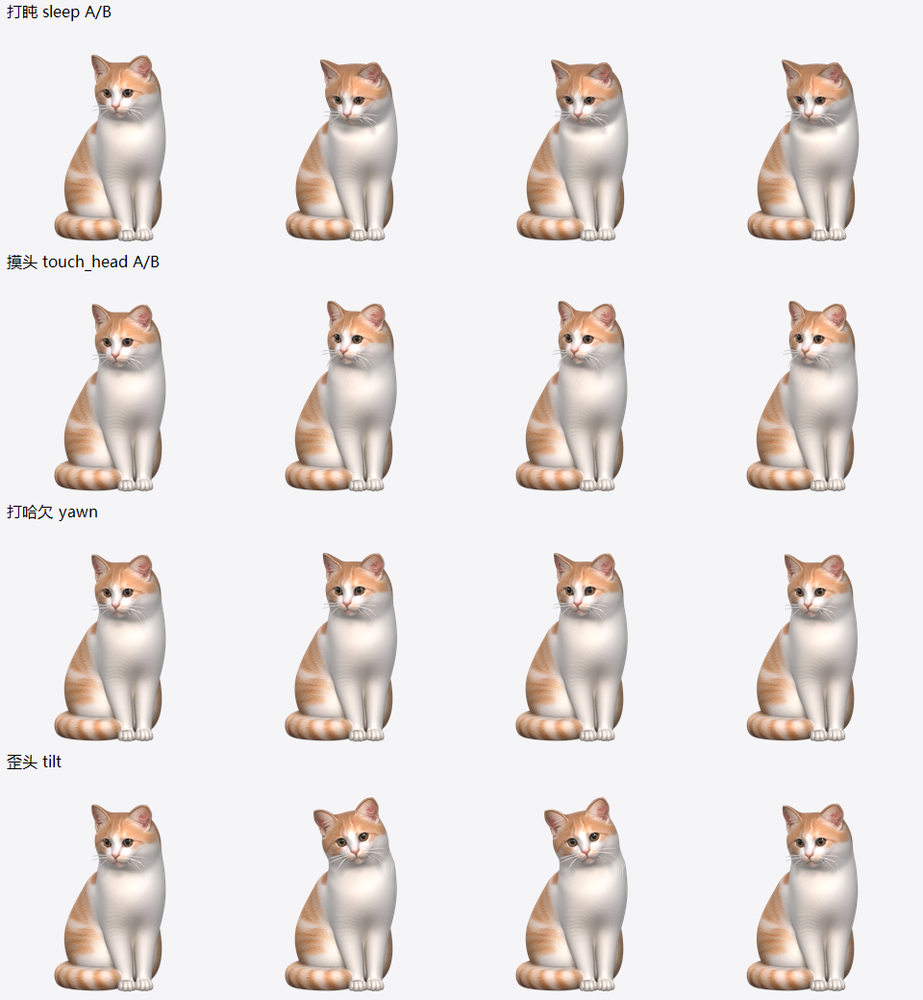
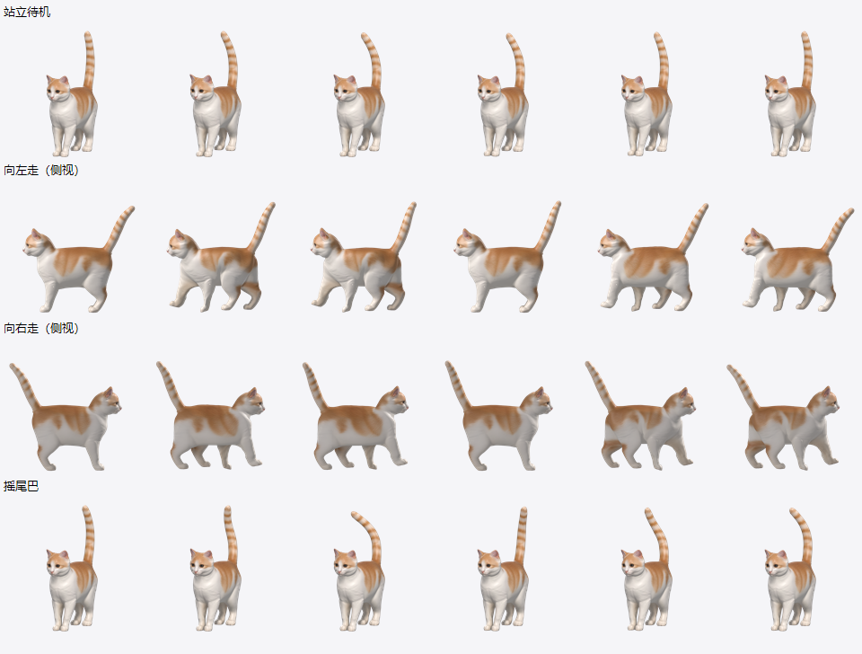

# CatPet · 猫咪桌宠

一只住在桌面上的猫。透明置顶窗口 + 逐帧 3D 渲染动画，会自己待机、打盹、散步、追鼠标，
也能当番茄钟和喝水提醒。

> 实现思路参考 [VPet（虚拟桌宠模拟器）](https://github.com/LorisYounger/VPet)：
> 资源目录结构与 `info.lps` 声明格式与 VPet 对齐，但代码与美术资源均为本项目自有实现。



## 它能做什么

| | |
| --- | --- |
| **待机小动作** | 侧脸坐着、舔毛、打哈欠、歪头、东张西望、抖毛、眨眼、打盹 |
| **会走路** | 坐久了站起来溜达（走 / 跑 / 飞奔），走到屏幕边自动停 |
| **跟随鼠标** | 脑袋跟着光标转；坐下时也会转脸看你 |
| **摸头** | 点脑袋有反应，连点会呼噜、最后甩头躲开 |
| **追鼠标小游戏** | 鼠标跑它追，追上会摇尾巴庆祝；够不着会抬头说"够不着喵" |
| **进出场运镜** | 启动时由远及近走进来，退出时转身走远，方向按最近的屏幕边界选 |
| **提醒** | 番茄钟、喝水 / 久坐提醒（在托盘图标里，默认不打扰） |
| **位置记忆** | 拖动后的位置、大小、设置都会记住 |



## 安装

从 [Releases](../../releases) 下载：

- `CatPet-Setup-x.y.z.exe` —— 安装包，双击装（Windows 10/11，自包含运行时，无需装 .NET）
- `CatPet-Portable-x.y.z.zip` —— 绿色版，解压即用

> 推 `v*` tag 会由 GitHub Actions 自动构建并发布这两个产物，见 [`.github/workflows/release.yml`](.github/workflows/release.yml)。

安装完会在开始菜单和桌面留快捷方式，可选择开机自启。

## 从源码运行

```powershell
# 需要 .NET 8 SDK
dotnet build .\CatPet\src\CatPet\CatPet.csproj -c Debug
.\CatPet\run.cmd
```

## 交互

| 操作 | 效果 |
| --- | --- |
| 左键拖动 | 搬家（松手记住位置） |
| 左键点脑袋 | 摸头 |
| 右键 | 菜单：动作、大小、设置、关于、退出 |
| 托盘图标 | 显示 / 隐藏、番茄钟、喝水提醒、退出 |
| 小游戏中单击猫 | 不玩了 |

## 技术概览

- **C# / WPF / .NET 8**，透明无边框置顶窗口，`Viewbox` 内统一用 500×500 逻辑坐标
- 动画是 **PNG 序列帧**：`{前缀}_{序号}_{帧时长ms}.png`，由 `info.lps` 声明动作与图集
- 美术来自一个 3D 猫模型：Blender 里减面 → 绑骨 → 逐帧渲染成透明 PNG → 缩到 330×330 入库
- 素材规格、烘焙管线、代码约定见 [`AGENTS.md`](AGENTS.md)

```
my_pet/
├── CatPet/                 # 桌面宠物本体
│   ├── src/CatPet/         # WPF 源码 + mod/MyCat 美术资源
│   └── tools/              # 素材校验 / 导入 / 打包脚本
├── artwork/                # Blender 烘焙脚本（模型与烘焙帧不入库）
├── docs/                   # 截图、开发笔记、VPet 源码分析
└── AGENTS.md               # 给开发/agent 的规范与踩坑记录
```

## 文档

- [`AGENTS.md`](AGENTS.md) —— 开发规范：素材规格、颜色/尺寸统一、烘焙流程、代码约定
- [`docs/dev-notes.md`](docs/dev-notes.md) —— 逐条实现笔记（很长，含踩坑）
- [`docs/VPet-分析报告.md`](docs/VPet-分析报告.md) —— VPet 的技术栈与 mod 机制分析

## 说明

- 美术资源（猫的序列帧）为本项目用自制 3D 模型渲染生成
- 与 VPet 无代码层面的复制关系，仅在资源格式上保持兼容以便复用生态工具
