# 开发笔记（历史）

> 这是开发过程中逐条记录下来的实现细节与踩坑，按时间累积，内容偏长。
> 面向 agent 的规则与约定见根目录 [AGENTS.md](../AGENTS.md)；项目简介见 [README.md](../README.md)。
> 说明：文中提到的部分脚本（`bake.py`、`bake_stand_walk.py`、`rig.py`、`match_sides.py` 等）
> 是当时的一次性/被取代脚本，现在已经移到 `archive/old-scripts/`，只在需要复盘时查看。


参考 [VPet](https://github.com/LorisYounger/VPet) 的核心实现（透明桌宠窗口 + PNG 序列帧动画 + 热区交互）做的
最小可运行版本。资源目录与 `info.lps` 声明格式与 VPet 对齐。

**形象来源：一个坐姿的 3D 猫模型**——在 Blender 里减面、绑骨、做动作，再渲染成 1000×1000 的透明序列帧，交给桌宠播放。
（早期试过「照片抠图 / AI 出图」的纯 2D 路线，效果不行，相关工具已移除。）

> 源码分析见 [`../docs/VPet-分析报告.md`](../docs/VPet-分析报告.md)

---

## 1. 跑起来

**双击 `run.cmd`**（自动使用仓库自带的 .NET 8 运行时）。

```powershell
# 或者命令行
$env:PATH = "<repo>\.tools\dotnet;$env:PATH"
dotnet build .\src\CatPet\CatPet.csproj
.\run.cmd
```

首次启动会把每段动画的帧拼成"精灵图"缓存在 `bin/.../cache/`（几秒），之后秒开。

## 2. 窗口大小

**拖拽调整**：右键 → 设置 → 调整大小，四角出现手柄，拖任意角等比缩放；完成后点底部 **✓ 确认** 保存并退出
（`Esc` / 「取消」恢复原大小）。

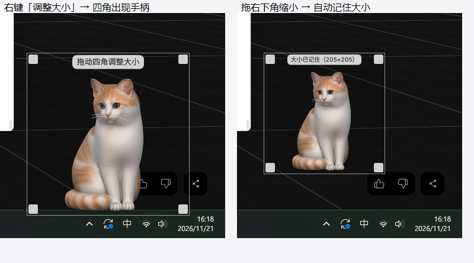

- 范围 125×125 ~ 1000×1000（缩放 0.25 ~ 2.0）
- 大小存在 `%LOCALAPPDATA%\CatPet\settings.json`，下次启动自动恢复
- 环境变量 `CATPET_ZOOM` 可临时覆盖（优先级：环境变量 > 配置文件 > 默认 0.55）

## 3. 能做什么

| 操作 | 反应 |
| --- | --- |
| 左键点**头顶** | 蹭手（`touch_head` A→B→C）+ 气泡（蹭蹭） |
| 左键点**别处** | 喵叫（`say` A→B→C）+ 随机一句 |
| 左键**拖拽** | 移动窗口 |
| 右键菜单 | **动作**：喵一声 / 摸摸头 / 舔舔毛 / 打个哈欠 / 重新待机<br>**设置**：总在最前 / 调整大小<br>退出 |
| **静置 14 秒** | 随机：转头 / 歪头 / 打哈欠 / 舔毛 / 叫一声 |
| **静置 25 秒** | 在「侧脸」和「正脸」两种待机之间切换一次 |
| **静置 90 秒**（首次） | 提示一句「右键托盘里的猫，可以定番茄钟」——托盘功能比较隐蔽，最多提示 3 次，用过计时后不再提示 |
| **启动时** | 按当前时段（早上好/中午好/晚上好/夜深了…）或节日（春节、中秋、圣诞…）问候一句，显示 5 秒 |
| **静置 45 秒** | 打盹（`sleep`），点一下叫醒 |

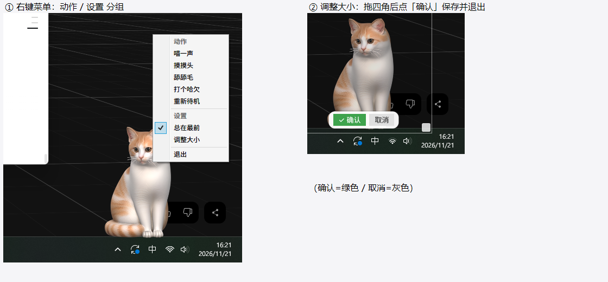

### 站立动作（方案 A 模型 · 附加）

`mod\MyCat\pet\cat\stand\` 里是**站立姿态**动作，来自方案 A 的重拓扑模型。**只做新增，不改动坐姿动作。**

| 动作 | 目录 | 帧数 | 视角 | 播放时 |
| --- | --- | --- | --- | --- |
| 站立待机 | `stand/sidle/` | 20 | 正面 3/4 | 循环 |
| 向左走 | `stand/swalk_l/` | 12 | 纯侧视（头朝左） | 3 轮 + **窗口左移** |
| 向右走 | `stand/swalk_r/` | 12 | 纯侧视（头朝右） | 3 轮 + **窗口右移** |
| 摇尾巴 | `stand/swag/` | 16 | 正面 3/4 | 2 轮 |

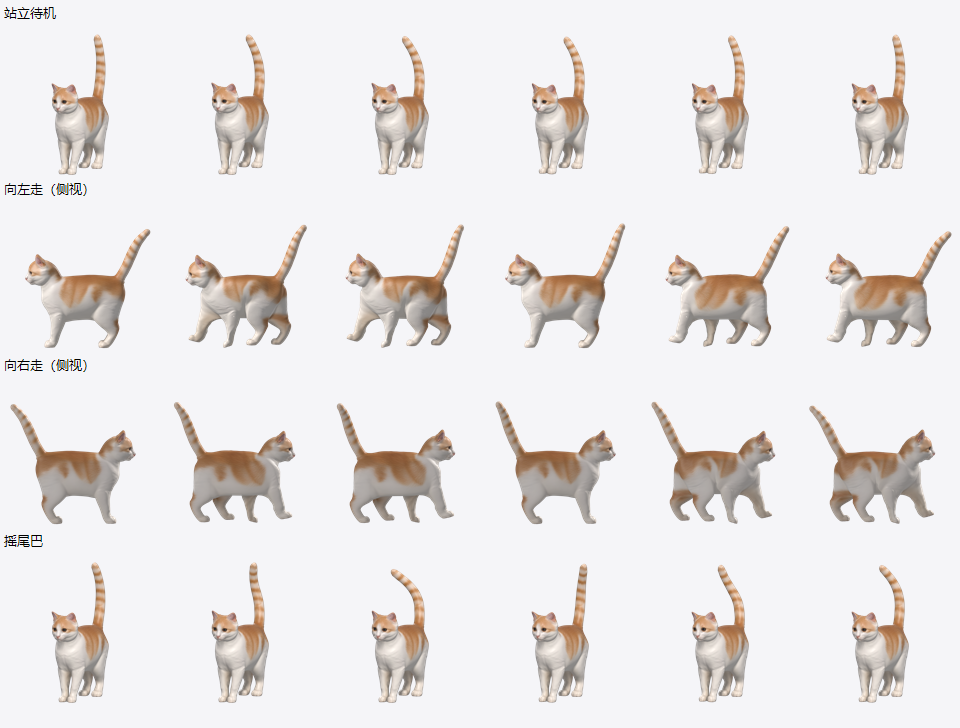

#### 姿态切换（坐姿 ↔ 站立）

```
点站立动作 → 先切帧（约 70ms）
          → 动作播完 → 停在「站立待机」（sidle 循环）
点坐姿菜单（喵一声/摸摸头/…）→ 切回坐姿待机
```

- 切换时窗口**不做缩放**，站姿素材按 88% 画幅烘焙，视觉大小接近坐姿
- 站立姿态期间，**14 秒随机小动作、25 秒换脸、45 秒打盹、90 秒功能提示都不会插播坐姿动作**（打盹改成先「站累了坐会儿」回到坐姿，再走正常流程）
- 想微调可改 `settings.json` 的 `StandZoom`（默认 1.0 = 不缩放）

#### 关心话（不绑定动作）

除了动作文案，猫还会**每隔 4~7 分钟**（随机）自己冒一句关心的话，只弹气泡、不换动画、不打断任何动作：

| 时段 | 文案 |
| --- | --- |
| 通用（14 句） | 工作再忙也要记得喝水喵 / 坐久了，起来动一动吧 / 今天也辛苦了喵～ / 别一直盯着屏幕，看看我吧 / 你已经很努力啦 / 累了就歇一会儿 / 我在这儿陪着你 / 保持专注，也别忘了休息 / 抬头伸个懒腰吧 / 忙完记得吃点东西 / 深呼吸一下，放松放松 / 你的努力我都看在眼里喵 / 工作加油～ / 眼睛累了就闭一会儿 |
| 深夜（21:00–05:00，额外 3 句） | 这么晚了，早点休息吧 / 熬夜对身体不好喵 / 夜里了，别太拼 |
| 早上（05:00–10:00，额外 2 句） | 早上好，今天也一起加油 / 新的一天，慢慢来就好 |

- 间隔每次随机（240~420 秒），不会太频繁
- 拖拽中 / 打盹中 / 调整大小中 / 窗口隐藏时跳过，40 秒后再试
- 气泡显示 4 秒（比普通文案长一点）
> **哪些文案带「喵」**
>
> | 类别 | 加喵 | 例子 |
> | --- | --- | --- |
> | 关心话 / 问候 / 撞边吐槽 / 站立菜单口语 | ✅ | 你已经很努力啦喵 / 下午好喵～ / 走到头了喵 / 运动一下喵～ |
> | 拟声词（喵叫） | ✅ 本身就是 | 喵～ / 喵呜～ / 喵？ |
> | 状态描述（括号类） | ❌ 不是猫在说话 | （蹭蹭）/（打呼噜）/（尝试舔毛中~）/（歪头） |
> | 界面提示 | ❌ 功能性强，保持清楚 | 已停止计时 / 大小已保存（228×228）/ 拖四角调整… |
#### 姿态轮换（坐累 / 站累）

闲置一段时间（约每 22 秒检查一次，且至少 18 秒没交互）时，会在坐姿和站立之间自己切换：

| 当前 | 行为 |
| --- | --- |
| 坐姿待机 | 55% 站起来待机（`（站起来活动活动）`）/ 45% 溜达一段（`（溜达一下）`） |
| 站立待机 | 60% 坐回来（`（坐会儿）`）/ 40% 溜达一段 |

**动作频率**可调（设置 → 动作频率：高 / 中 / 低），决定猫咪多久来一次走动、跑、飞奔这类大幅度动作：

| 档位 | 检查周期 | 坐着时溜达概率 | 站着时溜达概率 |
| --- | --- | --- | --- |
| 高 | 18 秒 | 60% | 60% |
| 中（默认） | 22 秒 | 45% | 40% |
| 低 | 28 秒 | 25% | 20% |

> **专注模式（番茄钟工作段）下完全不溜达**，只会安静地站起来 / 坐回去。

- 溜达会**优先朝空间大的一侧**走，避免刚起步就撞墙
- 正在播站立动作（走/摇尾）、拖拽、缩窗口、打盹时都不触发
- 站立动作本身不算「交互」，所以坐→站→走→坐会自然循环

#### 交互优先级

| 操作 | 坐姿时 | 站立时（走/摇尾中） |
| --- | --- | --- |
| **鼠标悬停** | 在猫身上显示**小手**指针（透明区域是穿透的，不显示） | 同左 |
| **左键拖拽** | 侧脸 → 正脸（**在正脸停 800ms**）→ 转回侧脸，配 `喵？` | 停走 + 回站立待机，保持站立，窗口跟随移动 |
| **左键单击** | 点头顶=蹭手，点别处=喵叫 | **停走 + 回站立待机**（不会变成坐姿）+ `喵？`/`喵～` |
| **右键 → 坐姿动作** | 播该动作 | 先缩窗口回坐姿，再播该动作 |
| **右键 → 站立动作** | 切到站立 | 换成新动作 |
#### 行走与屏幕边界

走路时窗口以 **55 px/s** 同向移动；**播完或撞到屏幕边缘就停**。撞边时会吐槽一句再回到站立待机：

| 撞边文案 |
| --- |
| 走到头了喵 / （撞墙了）/ 这边没路了喵 / 再走就出屏幕啦 |

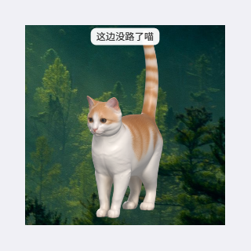

#### 文案

| 动作 | 气泡 |
| --- | --- |
| 站立待机 | （站起来看看） |
| 向左走 / 向右走 | 运动一下～ |
| 摇尾巴 | 喵～ 主人好 |

烘焙要点（`artwork/blender/bake_stand_walk.py`）：

- 侧视相机在 ±X 方向：`az=90` → 头朝画面左，`az=270` → 朝右；`az=25` 是正面 3/4：这个模型 `az=140` 拍到的是后背
- 取景用**变形后**的包围盒；`root` 是零长度骨骼，平移无效，升降要用 `armature.location.z`
- 每帧贴地（最低点对齐 z=0），否则中途姿势悬空，校验会报「未贴底」
- 模型没有口腔，张嘴看不出来，所以没做「叫」
### 气泡与设置窗口

**气泡在猫的图片上方**：窗口被拆成两行——上面是气泡带，下面是猫本体（保持正方形，不会被压小）。
窗口高度 = 宽度 + 气泡带，所以文字永远不遮挡猫。

- 默认字号 14px（原来是 30px，太大）
- 字号在设置里**自己填**（8~72px），气泡带高度跟着变（`字号 × 3.2 + 12`，够放两行）
- 窗口贴着屏幕左右边缘时，气泡会自动左右平移，保证完整显示
- 气泡 `IsHitTestVisible=False`，点到气泡也算点猫

**设置窗口**：右键猫 → 「设置…」，或托盘 → 「设置…」。所有数值都能直接输入：

| 分组 | 项 |
| --- | --- |
| 外观 | 气泡字号（px）、窗口总在最前、头部跟随（常开）、动作频率（低/中/高） |
| 番茄钟 | 专注时长（分钟）、休息时长（分钟）、专注结束自动休息 |
| 喝水/久坐 | 提醒间隔（分钟）、开启提醒（**默认关闭**） |\n| 系统 | 开机自动启动（写 HKCU Run，不需要管理员） |

输入非法时窗口里会红字提示（比如「专注时长要在 1 ~ 180 之间」），保存后立即生效并写入 `settings.json`。\n\n左下角「恢复默认」把所有项填回出厂值（窗口位置/尺寸和开机自启不在这个范围内），确认后再点保存。\n\n**默认关闭**:番茄钟不自动开始（点托盘才开始）、喝水/久坐提醒 `WaterRemindEnabled = false`。
#### 摸头闭眼

摸头用的是"眼睛贴片"方案（从闭眼模型渲染图上裁眼睛小块，贴到睁眼帧）：

- `close_eyes_actions.py`：逐帧检测眼睛位置，贴闭眼小块
- 原睁眼帧备份在 `artwork/blender/open_backup/touch_head/`

> 试过另一种做法——直接用闭眼模型的整图组成帧（`touch_head_from_closed.py`，含色调对齐 `closed_glb_matched_500.png`），
> 但风格与主模型仍有差异，已回退。
#### 站/坐切换不再上下跳

两个原因都修了：

| 问题 | 原因 | 修法 |
| --- | --- | --- |
| 切到站立时整窗往下掉 | `AnimateScaleTo` 里 `Top = 锚点 - size`，但窗口高度其实是 `size + 气泡带`，每次缩放都多下移一个气泡带 | 改成 `Top = 锚点 - (size + 气泡带)` |
| 站立帧比坐姿帧大一圈、地面线不齐 | 站立烘焙用的是 `L = h/0.88`，坐姿是 `0.82` | 站立四套（站立待机/走/摇尾/观察/跟随）全部按 `0.82` 重烘，地面线对齐（坐姿 485 / 站立 482，500px 画布） |

实测：367×424 窗口下站起，窗口位置 `dx=0 dy=0`，脚底和坐姿时在同一条线上。
### 代码 review 修复记录（潜在 bug）

这一轮做了静态审查（主窗口 / 小游戏与托盘 / Core 与启动），修掉的问题：

| # | 严重度 | 问题 | 修法 |
| --- | --- | --- | --- |
| 1 | **P0** | 素材加载失败时构造函数抛异常被全局处理器吞掉 → 没有窗口但进程活着、还占着单实例锁，之后永远起不来 | `PetLoader.Load` 包 try/catch：弹框说明 + `Shutdown(1)` 再抛 |
| 2 | **P0** | 睡眠 + 头部跟随互斥失败：`EndHeadFollow()` 在 `_asleep` 时播待机会取消打盹 → `_asleep=true` 但画面清醒，所有计时器被挡，猫永久定住 | 睡眠时只复位跟随状态、不播待机；`EndHeadFollow` 里 `if (_asleep) return;` |
| 3 | P1 | 旧动作的收尾会踩掉新动作（连点走路 → 第二下无效） | `PetPlayer.Generation` 代际号；`PlayStandAsync` / `PlayStandClosedAsync` / `ReturnSittingAsync` 在 await 后比对，过期就 return |
| 4 | P1 | 小游戏贴边死循环：`StartWalk` 在离边 `dx` 处停，而 `ChaseTick` 要求贴到边，于是每 40ms 重新 StartWalk→撞边→吐槽→写配置 | 边距判定加 `step = max(3, speed*0.06)`；小游戏里撞边不再吐槽/播待机 |
| 5 | P1 | 隐藏窗口（托盘/全屏）不结束小游戏 → 姿态轮换永久停、60 秒自动结束失效 | 两处隐藏前 `CloseInvite()` + `StopChase()` |
| 6 | P1 | 托盘 `NotifyIcon` 从不释放（`DisposeTray()` 是死代码）→ 幽灵图标；`OnClosed` 也没停 `_face/_blink/_tick/_hint/_scale/_walk/_chase` | `OnClosed` 全部停掉 + `CloseInvite()` + `DisposeTray()` |
| 7 | P1 | 邀约弹窗 `Show()` 抢焦点 + `IsDefault` → 用户按回车会误接受；打开设置/关于时弹窗浮在模态框上 | `ShowActivated="False"`、去掉 `IsDefault`、打开模态框前 `CloseInvite()` |
| 8 | P1 | 四角缩放把气泡带算进宠物体高，抓 TL/TR/BL/BR 时窗口会瞬间跳大一个气泡带；且 `PointToScreen` 物理像素与 DIP 混用（高 DPI 缩放速度不对） | 垂直量扣掉 `BubbleBandHeight`、`Top` 减去气泡带；坐标除以 `DpiScaleX/Y` |
| 9 | P1 | 缓存在程序目录（装到 `Program Files` 不可写）→ 拼图保存抛异常，整只猫没画面 | 缓存改到 `%LOCALAPPDATA%\CatPet\cache`；保存失败退到临时文件，仍失败则记错误但不再崩 |
| 10 | P1 | 用 `UriSource` 加载帧，安装路径含 `#`/`%` 时解析错 | 改用 `StreamSource`（并去掉会触发 `ImagingCache` 空 key 异常的 `IgnoreImageCache`） |
| 11 | P1 | `touchhead/touchbody` 的宽高为负/NaN 会让整个形象加载失败 | 新增 `ReadRect`：字段非法/非有限/宽高 ≤1 时回退默认热区 |
| 12 | P2 | 启动时没应用 `Topmost` 设置（XAML 写死 True） | 构造里 `Topmost = _settings.Topmost;` |
| 13 | P2 | `UpdateTrayText()` 从未被调用（托盘提示永远不更新） | `UpdateTimerBar()` 里调用 |

仍留待处理（记录在案）：

- 精灵图 LRU 只在 `ShowStaticAsync` 登记，普通动画的 `_sheet` 永不释放（内存长期占用）
- `StopWalk` 里 `SavePosition()` 同步写盘，起步/停步都会写一次
- 设置 `Save()` 非原子（截断后写），极端断电会丢配置
- 托盘菜单每次 `Clear()` 重建，旧菜单项没 `Dispose`
- 双屏不同缩放时鼠标坐标与窗口坐标仍可能不同源（`Chase.dart` 已按猫窗口 DPI 换算，跨屏场景待验证）
### 状态轮换梳理（节拍表）

| 计时器 | 间隔 | 作用 | 互斥保护 |
| --- | --- | --- | --- |
| `_idleTimer` | 14 s | 坐姿小动作（转头/歪头/哈欠/舔毛/抖毛/东张西望/发呆/跟随区间/喵） | 站立/跟随/睡眠/`ActionBusy`/交互后 6 s |
| `_faceTimer` | 25 s | 坐姿正脸↔侧脸互换 | 站立/睡眠/`ActionBusy`/跟随 |
| **`_blinkTimer`** | **6~11 s** | 眨眼（独立节拍） | 站立/睡眠/跟随/`ActionBusy` |
| `_postureTimer` | 18~28 s | 姿态轮换：站↔坐、溜达（走/跑/飞奔）、发起邀约 | 小游戏/`ActionBusy`/专注模式 |
| `_sleepTimer` | 5 s 检查 | 无交互 25~55 s（按时段）→ 打盹 | 小游戏/邀约弹窗/`ActionBusy` |
| `_followTimer` | 60 ms | 头部跟随鼠标 | 拖拽/调整大小/睡眠/动作占用 |
| `_careTimer` | 4~7 min | 关心话（不绑动作） | 拖拽/睡眠/隐藏 |
| `_fullscreenTimer` | 2 s | 全屏应用时自动隐藏 | — |

#### 这次 review 修掉的问题

1. **眨眼太罕见**：原来放在待机池里（1/11 概率 × 14 s ≈ 2.5 分钟一次），改成独立计时器 6~11 秒。
2. **小动作会被强行打断**：换姿势、姿态轮换、邀约、打盹都不检查"动作是否正在播"，可能把舔毛/东张西望切一半；新增 `_actionBusyUntil` 统一互斥（动作播 4 秒内别人让路）。
3. **刚被逗完就自娱自乐**：待机池没看 `_lastInteraction`；现在交互后 6 秒内不插小动作。
4. **邀约弹窗时可能打盹**：`CheckSleep` 只挡了小游戏，现在也挡邀约弹窗。

#### 已知但没改的

| 项 | 说明 |
| --- | --- |
| 站立时没有眨眼 | `blink` 素材只有坐姿一套；要补得烘站立版 `sblink` |
| 专注模式下仍有小动作 | 目前只屏蔽溜达+邀约；若想"安静陪伴"可在 `_idleTimer` 里加 `InFocusMode` 判断 |
| 喵叫权重偏高 | `IdleRoll()` 11 档里 `say` 占 2 档（≈18%），比单个动作多一倍 |
| 站立时动作偏单调 | 站立只有 slook 和溜达，可以考虑复用 `sclose`/新增站立小动作 |
### 待机邀约：一起玩？

待机轮换时（每 18~28 秒一次）有 **18%** 概率弹出一个邀约气泡卡：

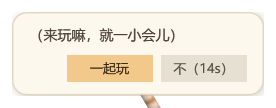

| 选项 | 行为 |
| --- | --- |
| **一起玩** | 进入追鼠标小游戏，**60 秒后自动结束**（气泡「（玩够啦，歇会儿）」） |
| **不（15s）** | 按钮上有 15 秒倒计时；点了或不理它，到点都算拒绝（气泡「（那我自己待着）」等） |
| 点猫咪本体 | 等同于关掉邀约 |

规则：

- **专注模式（番茄钟进行中）不发起邀约**；正在专注时开始计时也会把已开着的邀约关掉
- 拒绝或玩完之后有 **3 分钟冷却**，不会连着来问
- 邀约弹出前会先站起来（游戏是站立姿态）
- 气泡位置在猫头顶上方，超出屏幕就放到下方

手动触发：右键 →「小游戏」→「邀请一起玩」（方便试）。
### 小游戏：追鼠标

右键 → **小游戏 → 追鼠标（跟着鼠标跑）**（托盘菜单同一项），再点一次停止。

进入后小猫横向跟着鼠标跑：**只看横向位置**，竖向先不管：

| 鼠标离猫的水平距离 | 步态 |
| --- | --- |
| < 26px | 站住（sidle），不再左右抖 |
| 26 ~ 140px | 走 `swalk_l/r`（32 px/s） |
| 140 ~ 320px | 跑 `srun_l/r`（150 px/s） |
| > 320px | 飞奔 `sgal_l/r`（430 px/s） |

平滑性做了四件事：

1. **速度连续**：目标速度 = `距离 × 1.0 + 鼠标横向速度 × 0.4`，再用 0.2 的系数逐帧插值（加减速都不突变）
2. **步态滞回**：切到跑之后再掉到 140 以下不会立刻切回走（阈值放宽到 165）
3. **最小驻留**：两次步态切换至少间隔 260ms，避免速度卡在阈值上疯狂切换
4. **同名不重播**：只有步态真的变了才重新播片子，不会每帧重刷

实现放在 `PetWindow.Chase.cs`（partial class），40ms 一次 tick：

```
读鼠标 → 算距离/鼠标速度 → 算目标速度 → 平滑 → 选步态(滞回) → 切换片子(需要时) → 驱动窗口位移
```

#### 朝左 / 朝右两套站立素材（解决"停下时突然转向"）

原来站立只有一套朝左的素材（`sidle` + `sfollow`），小游戏往右追完停下时会突然变成朝左的姿势，很突兀。

新增镜像机位烘的右向素材（同一只猫、同一套动作，只是相机换到 −X 侧）：

| 素材 | 内容 | 相机 |
| --- | --- | --- |
| `stand\sidle` | 站立待机（20 帧 @110ms） | az=+25°（朝左） |
| **`stand\sidle_r`** | 同上，朝右 | **az=−25°** |
| `stand\sfollow` | 头部跟随 25×5 网格（125 帧） | az=+25° |
| **`stand\sfollow_r`** | 同上，朝右（yaw 序列镜像：+50 → −70） | **az=−25°** |

烘焙脚本：`bake_stand_idle_side.py`、`bake_follow_stand_r.py`。

程序侧：

| 改动 | 说明 |
| --- | --- |
| `_faceRight` 状态 | 播 `*_l` → 朝左，`*_r` → 朝右（`UpdateFacingFromClip`） |
| `PlayStandIdleForFacingAsync()` | 站立待机按朝向选 `sidle` / `sidle_r` |
| `FollowAtlas` | 朝右时用 `sfollow_r`；**列索引要反向**（`col = (50 − wantYaw)/5`），因为镜像机位的投影是左右翻转的 |
| 小游戏近区 | **只转头不换身位**：保持当前朝向的素材，用头部跟随去瞄鼠标（鼠标跨中线不会让整只猫翻面） |
| 近区半径 | 110px → **165px**（"看着鼠标"的区间更宽，过渡没那么突然） |

朝左/朝右的切换时机（避免"鼠标一动猫就翻面"）：

| 时机 | 身位 |
| --- | --- |
| 进入小游戏 | 按鼠标当时在左侧还是右侧决定初始朝向 |
| 鼠标在近区移动 | **保持身位不变**，只让头转（头部跟随，±38° 近场映射） |
| 真正开跑（走/跑/飞奔） | 按跑的方向切到对应身位（`*_l` / `*_r`） |

所以：鼠标在右边晃、猫站在左边时，猫会**扭头**去看，而不是整个身子翻到右边去。

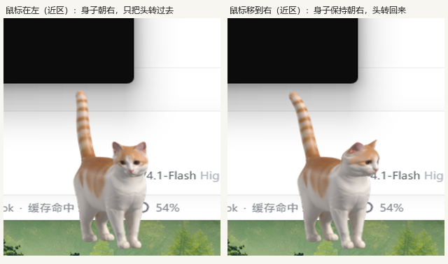
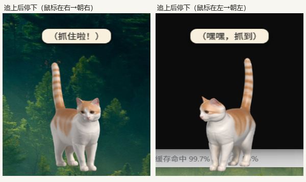
第一次进入小游戏会先弹一张玩法说明（只弹一次，记在 `settings.json` 的 `ChaseIntroSeen`）：


- 说明里也写了**怎么结束**：不想玩了点一下猫就收工
- 点「知道了，开始」→ 气泡倒数 **（3）（2）（1）**（约 2.1 秒）→ 才真正开始
- 说明卡和邀约弹窗一样贴在**气泡高度**（窗口顶部 +4px）
- 开场文案统一按「猫追鼠标」的视角：`（我来抓你咯）` / `（你要跑快点了喵）` / `（等等我！）`
- 邀约接受时说的是 `（我来了喵！）`，不再是「追我」
#### 开局不要"先朝左再朝右"

从右键菜单进入时，鼠标停在菜单上（多半在猫中心左侧），旧逻辑会先按这个位置定朝向 →
站成朝左，随后追逐方向又把身位翻到朝右，看上去闪一下。

现在的处理：

- **开局不按鼠标位置定朝向**，也不在 `StartChase` 里播待机
- 开局先「看你一眼」：`_chaseHoldUntil = now + 260ms`，这期间只站着（保持当前朝向）
- 260ms 之后才决定方向；身位切换发生在**真正开跑的那一刻**，读起来是"转身就跑"
- 小游戏里所有 `sidle` 都改成朝向感知（朝右时用 `sidle_r`），不会出现"停住时突然换边"
#### 三档行为 + 抓到 + 退出

| 鼠标与猫的水平距离 | 行为 |
| --- | --- |
| 远（> 110px） | **追**：距离越远越快，超过 430 还有额外加速，但**封顶 560 px/s** |
| 近（≤ 110px，鼠标自己凑过来） | **不追**，站住"**看**"鼠标（头部跟随，近场映射 ±38°） |
| 追到**身体接触**（猫身椭圆：半宽 = 窗口宽×0.42、半高 = 宠物体高×0.40） | **抓到了**：播 `swag` 摇尾巴 2 轮，**小游戏继续** |

抓到判定用**二维距离**（横向 + 纵向），只贴着横向不算：

```
dist2d = sqrt(dx² + dy²)   ≤ 110px 且 _chaseDir != 0（正在追）才算抓到
```

所以把鼠标停在猫的正上方（横向重叠、纵向 400px）不会算抓到，只会触发"看着它"。

抓到之后**不退出小游戏**：

| 阶段 | 行为 |
| --- | --- |
| 抓到瞬间 | 播 `swag`（摇尾巴 2 轮，约 1.4s）+ 气泡「（抓住啦！）」 |
| 1.5s 之内 | 暂停追逐判定（`_chaseCelebrateUntil`），让它把尾巴摇完 |
| 之后 | 继续追：鼠标再跑就会重新起步 |
| 冷却 2.6s | 期间不会重复触发抓到，避免贴着鼠标疯狂摇尾巴 |
#### 小游戏期间不会被"待机随机行为"打断

排查时发现真正的打断来源**不是姿态轮换，而是打盹**：

`CheckSleep()`（很久没交互 → 打盹）里有一段"站立姿态下先坐回去"，文案就是「（站累了，坐会儿）」——
小游戏里鼠标不动 45 秒就会触发，猫一坐下来，追逐就断了。

修法：

| 位置 | 处理 |
| --- | --- |
| `CheckSleep()` | 小游戏进行中直接 return（不打盹） |
| `ChurnPosture()` | 小游戏进行中直接 return（不轮换姿态） |
| `ChaseTick()` | 每 tick 刷新 `_lastInteraction`（玩游戏本身算"在互动"） |
| `StopChase()` | 退出时 `_postureTimer.Start()` 重新启动轮换（之前只改了 Interval，停掉后就再也不溜达了） |

实测：开始小游戏、鼠标停在近区 50 秒 → 全程只有 `sfollow`（看着鼠标），没有坐下/打盹。
退出方式：

- 右键菜单再点一次「停止追鼠标」
- 托盘菜单同一项
- **点猫咪本体** → 直接退出（气泡「不追啦喵～」）

起跳阈值与"够不着"的处理（这一版改的）：

- 起跳阈值 `JumpTriggerDy` 220 → **140**：鼠标在头顶 140px 以上就起跳，不会在老鼠上方来回踱步
- 横向还差 >60px 就**斜向扑**，只有鼠标几乎在正上方才原地跳
- 够不着时**先走近**（横向距离 > 115px 就继续追），走到差不多正下方才停下说 `（够不着喵）`
- 斜向跳的倾斜**完全由素材承担**，程序不再叠加 `PetTilt`（之前右侧符号反了，导致右跳朝下）
#### 落地换向不再闪"45° 待机"

落地时原本会先播一次站立待机（3/4 视角），下一拍才切到纯侧视的走/跑。
鼠标在跳跃中甩到反方向时，这一帧待机特别显眼（看着像原地转了 45° 再跑）。

现在：

- 落地**不播待机**，把 `_chaseClip` 清空，下一拍（40ms）直接按鼠标方向选走/跑/飞奔
- `ExitNearMode()`（从"看着鼠标"恢复追逐）也不再借 `EndHeadFollow()` 播待机，只清跟随状态

实测（跳跃中把鼠标甩到反方向）：

```
落地后 clip 序列: sjump_diag > swalk_l > srun_l > swalk_l > sfollow   ← 无待机
离开近场后序列:   sfollow > swalk_r > sgal_r > srun_r > swag_r > sfollow_r
```
原地跳的左右素材也是按朝向选的（`sjump` / `sjump_r`），但之前**朝向可能过期**：
贴着屏幕边追不过去时 `_chaseDir` 是 0，`_faceRight` 就停在上一次的方向，
结果鼠标在右边、跳出来却是朝左的素材。

现在起跳前会先把朝向对准目标：

```csharp
if (Math.Abs(delta) > 24) _faceRight = delta > 0;   // 起跳前对准鼠标
```

实测：鼠标在右上方时 `jump peak=154 diag=False` → 播 `sjump_r`，落地后 `sfollow_r`。
帧数与手感（本轮）：

- 跳跃帧数加密：原地跳 10 → **19 帧**、斜向扑 6 → **16 帧**（关键帧之间按 50ms 线性插值，总时长不变）
- 「扑空」反馈：跳跃落地没碰到鼠标时，气泡随机来一句
  `（差一点了喵）/（就差一点点…）/（再来一次喵！）`，5 秒节流，避免连着跳时刷屏

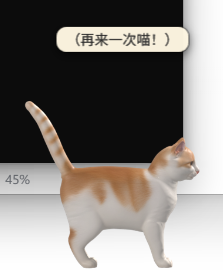
细节：进入小游戏后 800ms 内不判定"抓到"（因为开游戏时鼠标通常就停在猫身上），而且必须处于"正在追"的状态才算抓到——鼠标自己移到猫旁边只会触发"看着它"。

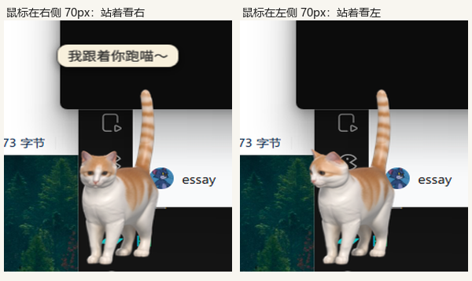
其它起跳阈值与"够不着"的处理（这一版改的）：

- 起跳阈值 `JumpTriggerDy` 220 → **140**：鼠标在头顶 140px 以上就起跳，不会在老鼠上方来回踱步
- 横向还差 >60px 就**斜向扑**，只有鼠标几乎在正上方才原地跳
- 够不着时**先走近**（横向距离 > 115px 就继续追），走到差不多正下方才停下说 `（够不着喵）`
- 斜向跳的倾斜**完全由素材承担**，程序不再叠加 `PetTilt`（之前右侧符号反了，导致右跳朝下）
#### 落地换向不再闪"45° 待机"

落地时原本会先播一次站立待机（3/4 视角），下一拍才切到纯侧视的走/跑。
鼠标在跳跃中甩到反方向时，这一帧待机特别显眼（看着像原地转了 45° 再跑）。

现在：

- 落地**不播待机**，把 `_chaseClip` 清空，下一拍（40ms）直接按鼠标方向选走/跑/飞奔
- `ExitNearMode()`（从"看着鼠标"恢复追逐）也不再借 `EndHeadFollow()` 播待机，只清跟随状态

实测（跳跃中把鼠标甩到反方向）：

```
落地后 clip 序列: sjump_diag > swalk_l > srun_l > swalk_l > sfollow   ← 无待机
离开近场后序列:   sfollow > swalk_r > sgal_r > srun_r > swag_r > sfollow_r
```
原地跳的左右素材也是按朝向选的（`sjump` / `sjump_r`），但之前**朝向可能过期**：
贴着屏幕边追不过去时 `_chaseDir` 是 0，`_faceRight` 就停在上一次的方向，
结果鼠标在右边、跳出来却是朝左的素材。

现在起跳前会先把朝向对准目标：

```csharp
if (Math.Abs(delta) > 24) _faceRight = delta > 0;   // 起跳前对准鼠标
```

实测：鼠标在右上方时 `jump peak=154 diag=False` → 播 `sjump_r`，落地后 `sfollow_r`。
帧数与手感（本轮）：

- 跳跃帧数加密：原地跳 10 → **19 帧**、斜向扑 6 → **16 帧**（关键帧之间按 50ms 线性插值，总时长不变）
- 「扑空」反馈：跳跃落地没碰到鼠标时，气泡随机来一句
  `（差一点了喵）/（就差一点点…）/（再来一次喵！）`，5 秒节流，避免连着跳时刷屏


细节：

- 进入时自动站起来、暂停待机溜达、让头部跟随让位（否则跟随会顶掉跑动画面）
- 贴着鼠标那侧屏幕边缘时站住等（不会反复触发撞边吐槽）
- 退出时回到站立待机并恢复溜达节奏

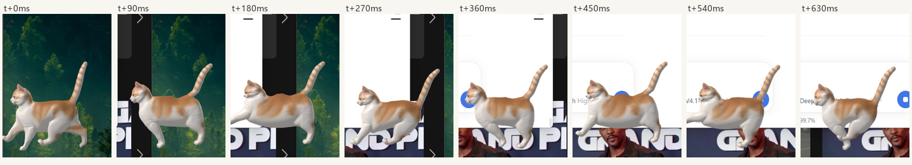
#### 修：站立摸头后闭眼不恢复

`PlayStandClosedAsync` 里代际号取早了：

```csharp
var gen = _player.Generation;                      // ✗ 播放前取
await _player.PlayStandClipAsync(clip, 3);
if (_player.Generation != gen) return;             // 必然不等 → 收尾永远不执行
```

`RunExclusive` 在**返回任务时**就把 `_generation` 自增了，所以 await 回来后一定不相等，
"播完回到站立待机"那一行永远跑不到 → 停在闭眼最后一帧。

改成先启动、后取代际：

```csharp
var play = _player.PlayStandClipAsync(clip, 3);
var gen = _player.Generation;                      // ✓ 播放后取
await play;
if (_player.Generation != gen) return;
```

实测：站立（朝右）摸头 → `sclose_r` 播 8×120ms×3 ≈ 2.9 秒 → 自动回到 `sidle_r`。
闭眼时长和坐姿对齐：

| 姿态 | 闭眼段 |
| --- | --- |
| 坐姿摸头 | `touch_head\b` 10 帧 × 110ms × 2 轮 = **2.2s**（前后还有 a/c 各 450ms 的睁眼过渡） |
| 站立摸头 | `sclose` 8 帧 × **137ms** × **2 轮** = **2.19s** |

（之前是 8×120×3 = 2.88s，明显偏长）
#### 纵向：够不着就抬头，够得着就扑

鼠标跑到猫咪**上方**时不再干瞪眼：

| 情况 | 行为 |
| --- | --- |
| 纵向差 ≤ 220px（贴近） | 站住**抬头/低头看**（复用跟随图集的俯仰行） |
| 纵向差 > 220px 且够得着 | **跳一次扑过去**（`sjump` / `sjump_r`，纯侧视） |
| 太高或连着跳两次都没碰到 | **先走近**（横向还有距离就一直追），够近了才停下抬头 + 气泡 **「（够不着喵）」**；**同一状态只说一次**，鼠标移动 40px 后才可能再提示 |
| 鼠标在下方 | 只低头看（猫不往下钻） |

跳跃实现：

```
窗口 Top 走抛物线：Top = ground - peak * 4p(1-p)，p = t/550ms
peak = |鼠标相对身体中心的纵向差|，上限 300px
落地回到起跳前的 Top（地面线不变），冷却 900ms
空中碰到鼠标 → 记 pending，落地瞬间才结算（不会半空摇尾巴）
庆祝 1.5s 期间不再起跳
```

跳跃分两种，各自有素材和运动方式：

| 触发 | 素材 | 动作 | 窗口运动 |
| --- | --- | --- | --- |
| 鼠标**正上方**、猫咪没在跑 | `sjump` / `sjump_r`（**19 帧**，共 0.96s） | 蹲下蓄力 **100 + 140ms** → 蹬地 → 缩腿腾空 → 伸腿落地 | 原地垂直抛物线（蓄力期间贴地不动） |
| 鼠标在上方且**横向还有距离**（>60px） | `sjump_diag` / `sjump_diag_r`（**16 帧**，共 0.8s） | 短蓄力 **160ms** → 奔跑中一跃而起，身体随风向倾斜（+24°/+36°/0°/−18°） | **斜向**：横向照常走 + 纵向抛物线，到顶点放平再落 |

节奏（都比最初放慢了一档）：

| 参数 | 值 |
| --- | --- |
| 蓄力（原地跳 / 斜向跳） | **240ms / 100ms**（之前 450/160，蹲太久拖节奏） |
| 空中时间 | 550ms → **700ms** |
| 跳跃高度 | `min(230, |鼠标高出量| - 45)`（不用跳到鼠标中心，身体椭圆有半高） |
| 追速上限 | 560 → **480** |

斜向跳的倾斜是"烘"进素材的（`hips` pitch：起飞 +14° → 上升 +24° → 顶点 0° → 下落 −12°），
运行时不再叠加旋转；原地跳才用 ±6° 的运行时切线倾斜。

起跳阈值与"够不着"的处理（这一版改的）：

- 起跳阈值 `JumpTriggerDy` 220 → **140**：鼠标在头顶 140px 以上就起跳，不会在老鼠上方来回踱步
- 横向还差 >60px 就**斜向扑**，只有鼠标几乎在正上方才原地跳
- 够不着时**先走近**（横向距离 > 115px 就继续追），走到差不多正下方才停下说 `（够不着喵）`
- 斜向跳的倾斜**完全由素材承担**，程序不再叠加 `PetTilt`（之前右侧符号反了，导致右跳朝下）
#### 落地换向不再闪"45° 待机"

落地时原本会先播一次站立待机（3/4 视角），下一拍才切到纯侧视的走/跑。
鼠标在跳跃中甩到反方向时，这一帧待机特别显眼（看着像原地转了 45° 再跑）。

现在：

- 落地**不播待机**，把 `_chaseClip` 清空，下一拍（40ms）直接按鼠标方向选走/跑/飞奔
- `ExitNearMode()`（从"看着鼠标"恢复追逐）也不再借 `EndHeadFollow()` 播待机，只清跟随状态

实测（跳跃中把鼠标甩到反方向）：

```
落地后 clip 序列: sjump_diag > swalk_l > srun_l > swalk_l > sfollow   ← 无待机
离开近场后序列:   sfollow > swalk_r > sgal_r > srun_r > swag_r > sfollow_r
```
原地跳的左右素材也是按朝向选的（`sjump` / `sjump_r`），但之前**朝向可能过期**：
贴着屏幕边追不过去时 `_chaseDir` 是 0，`_faceRight` 就停在上一次的方向，
结果鼠标在右边、跳出来却是朝左的素材。

现在起跳前会先把朝向对准目标：

```csharp
if (Math.Abs(delta) > 24) _faceRight = delta > 0;   // 起跳前对准鼠标
```

实测：鼠标在右上方时 `jump peak=154 diag=False` → 播 `sjump_r`，落地后 `sfollow_r`。
帧数与手感（本轮）：

- 跳跃帧数加密：原地跳 10 → **19 帧**、斜向扑 6 → **16 帧**（关键帧之间按 50ms 线性插值，总时长不变）
- 「扑空」反馈：跳跃落地没碰到鼠标时，气泡随机来一句
  `（差一点了喵）/（就差一点点…）/（再来一次喵！）`，5 秒节流，避免连着跳时刷屏


细节：

- 两侧都直接用正的 pitch（`PITCH_SIGN = 1`）：曾经按"相机镜像"给右侧反号，导致右跳朝下倾斜，已改回
- 蓄力阶段窗口贴地不动（`_chaseJumpDelayMs = 340`），蓄力结束后才起抛物线
- 贴到屏幕边、横向挪不动时自动退回"原地跳"，不做假的斜扑

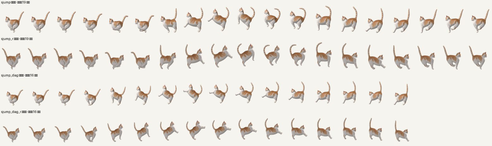

朝左 / 朝右斜向扑逐帧对照（上升抬头、顶点放平、下落低头）：

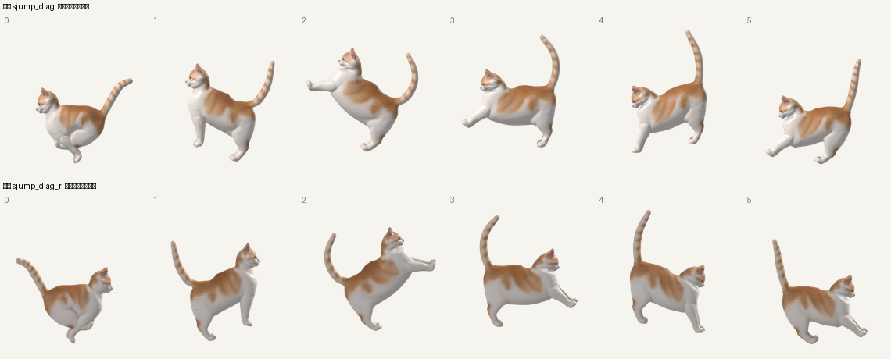
**斜向上扑的姿态**来自两层：

1. 素材本身：腾空帧给 `hips` 加了 pitch（+22°/+28°/+16°），猫身沿抛物线抬头
2. 运行时：窗口内容再按抛物线切线转 ±6°（`PetTilt`，上升顺时针=抬头，下降反向），落地归零

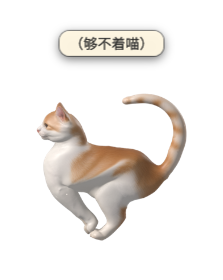

**不会卡死的三种情况**（都实测过）：

| 场景 | 处理 |
| --- | --- |
| 鼠标停在正上方不动 | 扑到一次后要求"鼠标先动起来"才允许再扑（`_chaseJumpNeedsMove`），之后站住抬头 |
| 鼠标停在正下方 | 进"低头看"分支（`deltaY > 220 && 横向 ≤165`），不会追→贴边→换向地来回翻 |
| 鼠标几乎在正前方/正后方 | 方向死区：`|delta| < 24px` 时保持原方向，避免抖动翻面 |


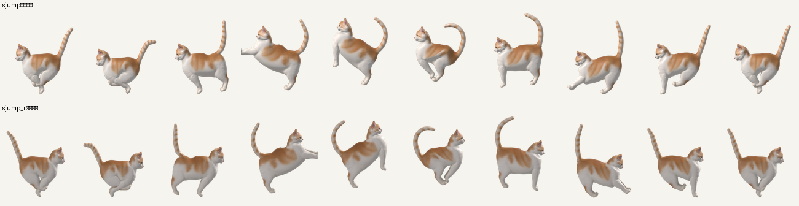

跳跃素材：10 帧 @60ms（蓄力 → 蹬地 → 收腿腾空 → 伸腿落地 → 缓冲），
和走/跑/飞奔一样是**纯侧视**（az=±90），朝左朝右各一套。
#### 站立动作现在左右都齐了

| 动作 | 左 | 右 |
| --- | --- | --- |
| 待机 | `sidle` | `sidle_r` |
| 头部跟随 | `sfollow` | `sfollow_r` |
| 走 / 跑 / 飞奔 | `swalk_l` / `srun_l` / `sgal_l` | `swalk_r` / `srun_r` / `sgal_r` |
| 摇尾巴 | `swag` | `swag_r` |
| **观察四周** | `slook` | **`slook_r`** |
| **闭眼待机（摸头）** | `sclose` | **`sclose_r`** |

程序里统一走 `SideClip(left, right)`：朝右且素材存在时用右向版本，否则退回左向。

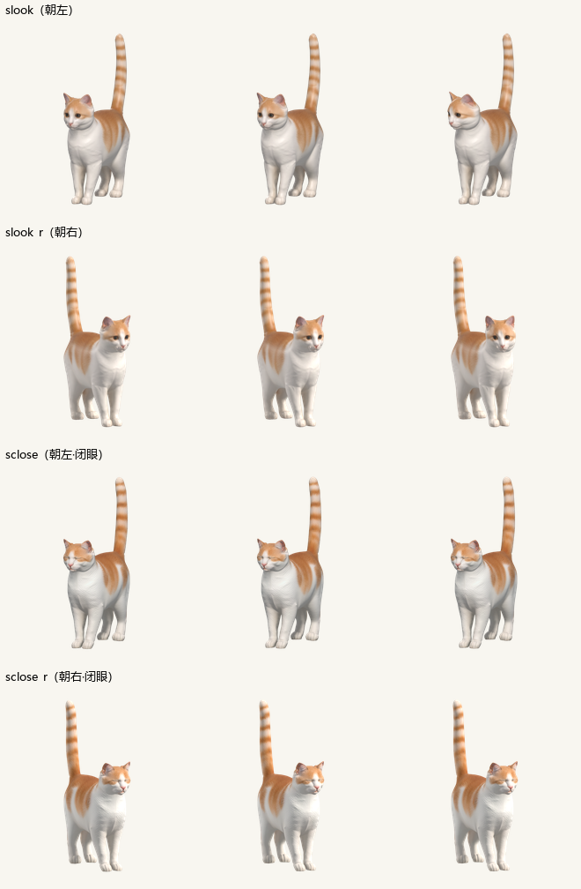

另外**统一了左右亮度**：相机换到 −X 侧后看到的是背光面，同一只猫会整体暗 15~20
（实测 sidle 190/170/155 → sidle_r 169/152/140）。用 `match_sides.py` 按左右对应动作的
平均 RGB 求逐通道**增益**（不是加减偏移，保住暗部），把右向素材拉回与左向一致（残差 ≈1）：

```
sidle_r  增益 1.123/1.117/1.106   对齐后残差 0.9/0.6/0.5
swag_r   增益 1.120/1.114/1.104   对齐后残差 0.9/0.6/0.5
… 共 8 组左右动作
```
#### 摇尾巴也有左右两套

抓到之后要摇尾巴庆祝，但原来只有朝左的 `swag`，向右追到时播放会突然翻个身。新增 `swag_r`（同一套动作、相机换到 −25°）：

| 素材 | 帧数 | 相机 |
| --- | --- | --- |
| `stand\swag` | 16 帧 @90ms | az=+25°（朝左） |
| **`stand\swag_r`** | 16 帧 @90ms | **az=−25°（朝右）** |

用在哪：

- 小游戏「抓到」→ 按当前朝向选 `swag` / `swag_r`
- 右键「摇尾巴」→ 同样按朝向挑（朝右时用 `swag_r`）

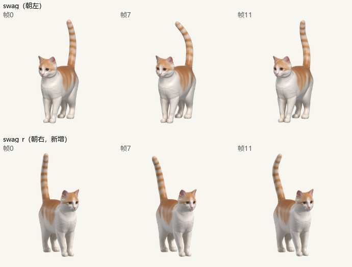
### 飞奔（gallop，左右都有）

在「走 / 跑」之上再加一档：**两条前腿同时前伸、两条后腿同时后蹬**，有真正的腾空期。

| 项 | 走 `swalk_l/r` | 跑 `srun_l/r` | **飞奔 `sgal_l/r`** |
| --- | --- | --- | --- |
| 帧数 / 单帧 | 12 × 90ms | 8 × 60ms | **12 × 36ms** |
| 一轮 | 1.08s | 0.48s | **0.43s** |
| 移动速度 | 32 px/s | 150 px/s | **430 px/s** |
| 腾空 | 无 | 无 | **有（0.09 × 身高）** |

烘焙脚本 `bake_stand_gallop.py`：

- 4 个关键姿势（蜷缩 → 蹬地 → 腾空伸展 → 落地）+ **循环 Catmull-Rom** 插值
- 落地高度逐帧算完后沿循环做 3 抽头平滑（避免"哪只脚最低"切换时抖 1~3px）
- 只把**脚部顶点**当触地基准，头压得再低也不会把整只猫抬起来
- 躯干统一 −2° 上拱，抵消四肢拉扯造成的"中段下凹"
- 前腿抬起角度上限 −42°，避免挤压脸部

入口与触发：

| 方式 | 说明 |
| --- | --- |
| 右键 → 站立动作 → 向左飞奔 / 向右飞奔 | 手动播 3 轮 |
| 站立待机溜达 | 空间 > **2.6 倍窗口宽**且非专注模式时，**12%** 概率升级成飞奔（播 2 轮），气泡「（冲啊！）」等 |

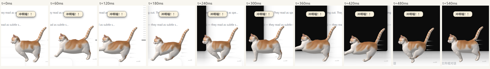

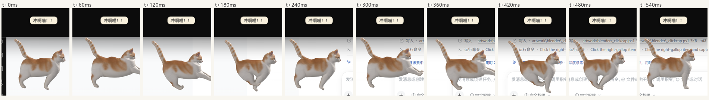

> 试过给帧加"动感线"（猫身后拖 5 条渐隐速度线），效果偏噪、也容易和桌面壁纸打架，最终没有采用。
### 奔跑（先做了向左）

| 项 | 走 `swalk_l` | 跑 `srun_l` |
| --- | --- | --- |
| 帧数 / 单帧 | 12 帧 @90ms | **8 帧 @60ms** |
| 一轮 | 1.08 s | **0.48 s** |
| 前腿 / 后腿摆幅 | ±30° / ±26° | **±24° / ±26°**（第一版 46/52 太夸张 → 34/38 → 24/26） |
| 窗口移动速度 | **32 px/s** | **150 px/s** |
| 姿态 | 直立 | 前倾、**颈 +7°、头 +9°（低头前探）**、耳朵后压、尾巴后拉 |

落地处理用**两遍**：先量整轮最低点，再统一抬高，只有最低那一帧真正触地，其余帧自然离地（有腾空感）。

入口：右键 →「站立动作」→「向左跑 / 向右跑」（播 4 轮 ≈ 1.9 秒，气泡「跑起来喵！」，结束后回站立待机）。

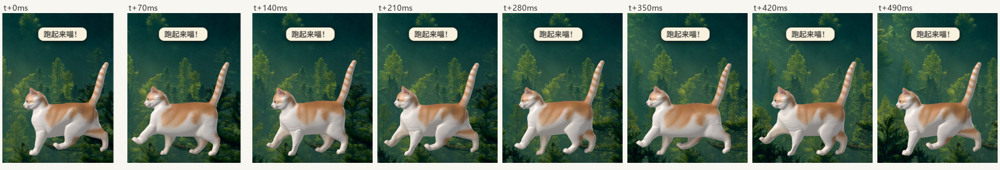
#### 待机时自己跑一段

站立溜达（`StrollOnce`）现在会挑「走」还是「跑」：

```csharp
var room = left ? roomLeft : roomRight;              // 那个方向还剩多少空间
var canRun = !InFocusMode && room > Width * 1.8;     // 空间够（约 1.8 个窗口宽）
var run = canRun && Random.Shared.NextDouble() < 0.45;
```

- 离那个方向的屏幕边缘**还远**（> 1.8 倍窗口宽）才有机会跑，否则老实走
- 专注模式（番茄钟）里一律不跑，也不溜达
- 跑的时候气泡换成「（冲一段）」「（跑两步）」「（撒欢）」
- 跑 4 轮 ≈ 1.9 秒 × 150 px/s ≈ 288 px，所以在 495px 以上的空间里不会撞边
### 站立姿态的闭眼（摸头）

用另一份**站立闭眼模型**（`300b7f1d…glb`）做了 `stand/sclose`：

| 步骤 | 说明 |
| --- | --- |
| 1 | 用站立素材同一机位渲染闭眼模型（`L=h/0.82`、`az=25°`、`el=7°`） |
| 2 | 缩到 500、按「高度 + 底部中心」对齐到 `sidle` 帧 |
| 3 | 色调对齐：整图减掉与 `sidle` 的平均 RGB 差（13.4 / 9.8 / 8.6） |
| 4 | 合成 8 帧（120ms），带 ±1px 的呼吸起伏 |

触发：**站立时点猫头顶** → 播 3 轮 `sclose`（约 2.9 秒）+ 气泡「（呼噜呼噜）」，然后回到站立待机。

> 顺带修了个交互 bug：头部跟随时长（`HeadFollow` 常开或跟随区间内）会把刚起来的动作顶掉，
> 现在播动作期间会让跟随完全让位（`_followPausedUntil`），连"结束跟随"都不做。

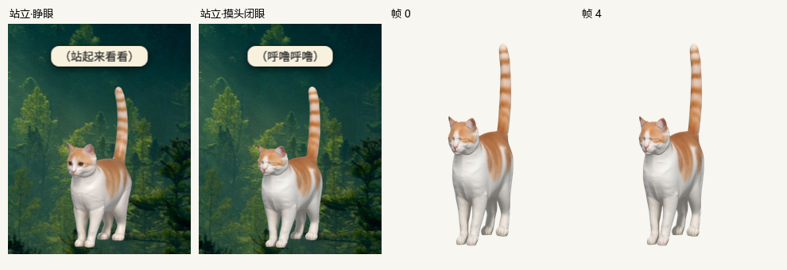
### 窗口位置记忆 / 单实例 / 全屏避让

| 功能 | 行为 |
| --- | --- |
| **位置记忆** | 退出、拖拽结束、走路结束时把 `Left/Top` 存进 `settings.json`；下次启动恢复。位置若已不在任何屏幕上（拔了副屏）自动回右下角 |
| **单实例** | 用 `Local\CatPet.SingleInstance` 互斥量；重复启动时把已经在跑的那只显示并切到前台，自己退出 |
| **全屏避让** | 每 2 秒检查前台窗口是否占满整块屏幕（视频/游戏/演示）；占了就自动隐藏，退出全屏后自动回来。托盘手动隐藏的状态不会被这个逻辑覆盖 |

### 时段行为

猫的作息会随系统时间变化：

| 时段 | 打盹阈值 | 待机偏好 |
| --- | --- | --- |
| 05:00–10:00 早上 | 55 秒（精神好） | 多转头/东张西望 |
| 12:00–15:00 午后 | 35 秒（易困） | 多打哈欠、呆望 |
| 22:00–05:00 深夜 | 25 秒（很快犯困） | 多呆望、少折腾 |
| 其它 | 45 秒 | 默认 |

### 摸头连击

连续点猫头顶（间隔 2.5 秒内）：

- **第 5 下** → `（呼噜呼噜~ 舒服）`
- **第 10 下** → 甩毛动画 + `够了喵！（甩甩头）`，计数归零

### 内存与日志

| 项 | 做法 |
| --- | --- |
| **精灵图缓存** | 最多保留 12 张（约 20 MB/张），超出按 LRU 释放；释放后强制 GC 一次（最多每分钟一次，后台线程） |
| **精灵图尺寸** | 单帧 380px（窗口默认 228px 够用；原来 500px 白占内存） |
| **实测内存** | 改动前峰值 500+ MB 且持续上涨（最坏 1.3 GB）→ 现在**稳定在约 200 MB**，甚至回落 |
| **崩溃日志** | `catpet-error.log` 超过 1 MB 自动轮转，保留 `.1`~`.4` 共 5 份；启动时也检查一次；托盘「打开日志文件夹」直达 |
### 头部跟随鼠标

猫会转头看鼠标，**全屏范围**（不限于窗口附近）。素材是预烘的角度网格：

| 姿态 | 目录 | 网格 | 帧数 |
| --- | --- | --- | --- |
| 坐姿 | `follow/` | 水 **25 档（-50°~+70°**，步长 5°）× 俯仰 **5 档**（抬 20/10、平、低 10/20） | **125** |
| 站立 | `stand/sfollow/` | 同上 | **125** |

索引 `idx = row * 25 + col`（row 0=抬头 20° … row 4=低头 20°；col 10 = 中立 0°）。\n\n右侧特意多给 20°：因为待机是 3/4 侧脸（相机偏 22°），同样转 50°，往右看会转向镜头显得"没动"，往左看才明显。

映射方式：以**猫头在屏幕上的位置**为原点（不是屏幕中心）——鼠标在猫头顶就是抬头、在脚下方就是低头，猫被拖到屏幕角落也不会错位。水平参考跨度约 0.7×屏宽、垂直约 0.35×屏高，程序每 **60ms** 采样一次，一次最多追 3 格（≈15°/60ms），快速甩鼠标也能跟上。

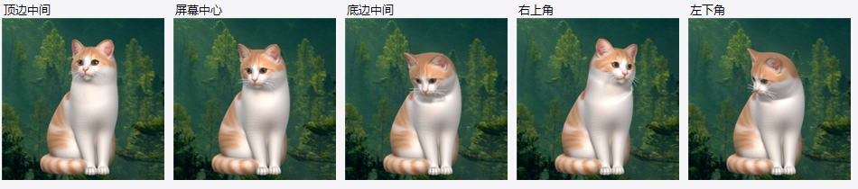

#### 两种模式

| 模式 | 开关 | 行为 |
| --- | --- | --- |
| **动作区间**（默认） | 「头部跟随（常开）」**不勾** | 待机随机池里 1/10 概率进入 **9~14 秒**跟随区间，区间内看鼠标，结束自动回其他动作 |
| **常开** | 勾上 | 一直跟随，不插播其他动作（气泡文案照常） |

其它规则：

- 站姿 / 拖拽 / 调整大小 / 打盹时暂停；站姿下自动切到 `sfollow` 素材
- 跟随期间不会插入随机小动作，被打断也会在 800ms 内自己恢复
- 开关存 `settings.json` 的 `HeadFollow`（默认 `false` = 动作区间模式）
### 素材尺寸与体积

素材帧统一 **500×500**（默认窗口 228×228，约 2.2× 余量）：

| 阶段 | 尺寸 | mod 体积 |
| --- | --- | --- |
| 最初 | 1000×1000 | 409 MB |
| 一次缩 | 700×700 | 207 MB |
| **当前** | **500×500** | **105 MB** |

- 存量帧用 `tools\resize-frames.ps1` 批量缩（双三次 + 保留 alpha，已缩放过的自动跳过）
- 烘焙脚本的 `resolution_x/y` 已统一为 500，以后新烘的素材直接是这个尺寸
- `tools\validate-frames.ps1` 的 `-Canvas` 默认 500
### 闭眼（眨眼 / 打盹）

坐姿模型本身没有眼睑，眼睛是实体眼球 + 高光材质，**只改烘焙贴图做不出闭眼**（试过，会变成"浑浊玻璃眼"）。
改用用户提供的闭眼模型（`d713f6a6…glb`，同款猫、同姿势、真闭眼）：

1. `render_closed_glb.py`：用坐姿完全相同的机位/取景渲染闭眼模型
2. `compose_closed_glb.py`：按"高度 + 底部中心"把闭眼模型对齐到现有帧，只取**眼睛小块**叠上去，
   这样身体、光影都是原来的，不会闪
3. `make_blink.py`：生成眨眼 5 帧（睁 → 半闭 → 闭 → 半闭 → 睁），落进 `blink/`
4. `close_sleep_eyes.py`：逐帧检测打盹时的眼睛位置，把闭眼小块贴上去（原帧备份在 `artwork/blender/sleep_open_backup/`）

结果：
- 新增动作 **眨眼** `blink/`（5 帧），进待机随机池（11 路里 1 路），不出气泡
- **打盹 30 帧、摸头 20 帧、打哈欠 16 帧改成闭眼**；舔毛（28 帧）保持睁眼——舔毛时头会低下去转，贴片容易贴歪、风格也不统一，已回退

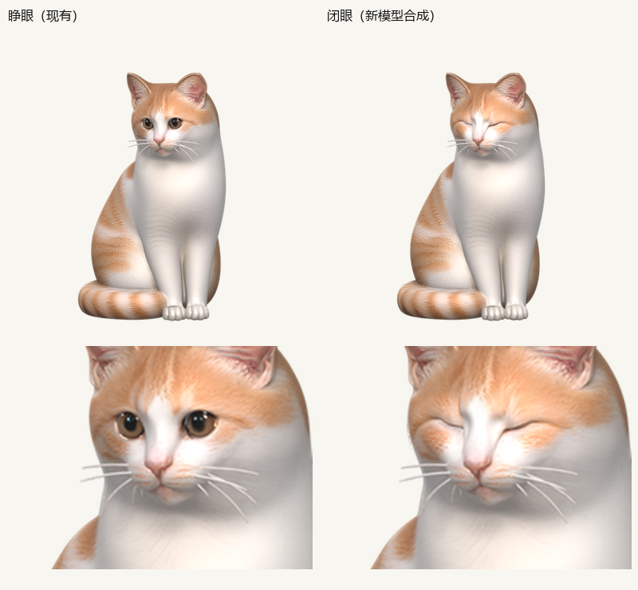

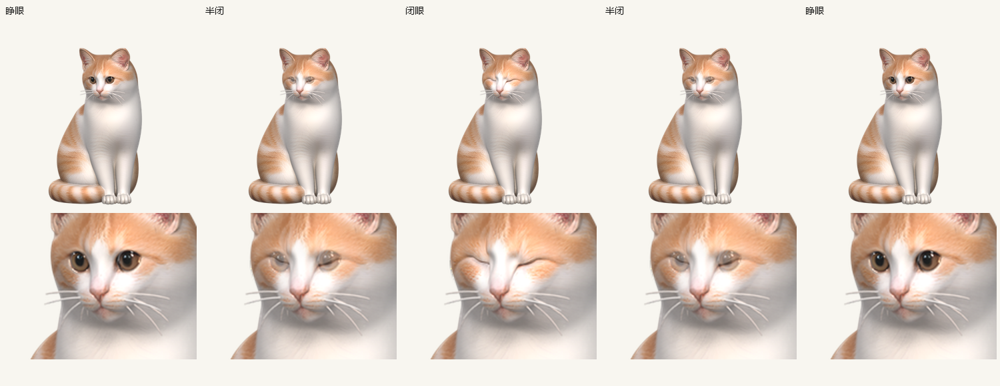
### 坐姿小动作（3 个）

4 个短小动作里保留了 3 个（**甩尾巴已去掉**：坐姿模型的尾巴只要转动就会撕开臀侧网格）：

| 动作 | 目录 | 帧数 | 单帧 | 文案 |
| --- | --- | --- | --- | --- |
| 抖抖毛 | `shake/` | 16 | 55ms | （抖了抖毛）/（甩甩头） |
| 东张西望 | `look_around/` | **42** | **80ms** | （东张西望）/（好像听到了什么）/（四处看看） |
| 呆望 | `gaze/` | 20 | 120ms | （望着窗外发呆）/（发呆中） |

站立姿态也有一个「观察四周」`stand/slook/`（**42 帧 @80ms**），会出现在站立的姿态轮换里。

东张西望的节奏是**从中立姿势起步**：`中立(4帧) → 左看(2.2s 转+停) → 回中 → 右看 → 回中(收在 0°)`，首尾都是中立姿态，接回待机不会跳。

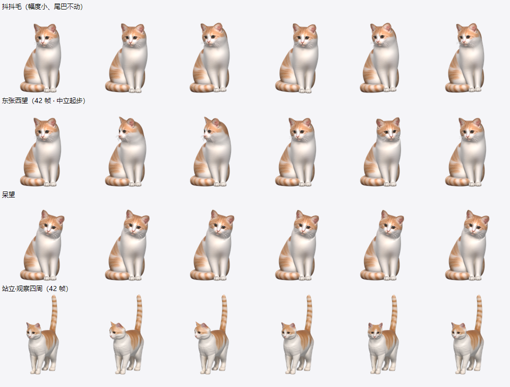

**待机随机池 9 路**（转头 / 歪头 / 哈欠 / 舔毛 / 喵叫 / 抖毛 / 东张西望 / 呆望 / 兜底喵叫），每 14 秒掷一次。

烘焙红线（`artwork/blender/bake_extra.py`）：

- **坐姿尾巴完全不能动** —— 只要 `tail_1..5` 有角度，臀侧网格就会撕开一块平面。抖毛、东张西望、呆望、站立观察四周全部保持尾巴静止
- **东张西望必须用「世界 Z 轴」转头**：模型头骨的本地 Z 轴倾斜了 90°（`Z = (-0, -0.94, -0.33)`），直接用本地 Z 转出来是**歪头**而不是水平转 —— 要用 `pb.matrix` 绕世界 Z 轴、以骨骼头为轴心旋转
- **站立观察四周时身体不跟随倾斜**，只有头和脖子转
- 抖毛靠 `root` 每 2 帧反向旋转（峰值 3.6°，太大像犯病）+ 耳朵后压 16° + 头部反向补偿
### 启动问候

程序启动时猫会说一句问候，规则：

| 时段 | 文案（三选一） |
| --- | --- |
| 05:00–09:00 | 早上好～ / 早上好，新的一天 / 早～（伸了个懒腰） |
| 09:00–11:00 | 上午好～ / 上午好，慢慢来 / 上午好，一起加油 |
| 11:00–13:00 | 中午好，记得吃饭 / 中午好～ / 中午好，歇一会儿吧 |
| 13:00–18:00 | 下午好～ / 下午好，来杯水？ / 下午好，别太累 |
| 18:00–22:00 | 晚上好～ / 晚上好，今天辛苦了 / 晚上好，摸摸头 |
| 22:00–01:00 | 夜深了，早点睡 / 还不睡呀…… /（打了个哈欠） |
| 01:00–05:00 | 凌晨了，快去休息 /（困得睁不开眼）/ 这么晚还没睡… |

节日会盖过纯时段问候，格式是「时段 + 节日」，比如 `晚上好，中秋快乐`：

| 类型 | 支持 |
| --- | --- |
| 公历 | 元旦、情人节、妇女节、愚人节、劳动节、青年节、儿童节、教师节、国庆（含 10/1–10/7 假期）、平安夜、圣诞、跨年夜 |
| 农历 | 除夕、春节、元宵、端午、七夕、中秋、重阳 |

农历用 .NET 内置的 `ChineseLunisolarCalendar` 换算，闰月会自动跳过。

调试时可以用环境变量模拟日期，验证节日文案：

```powershell
$env:CATPET_NOW = "2026-02-17 09:30"   # 春节
.\CatPet\run.cmd
```

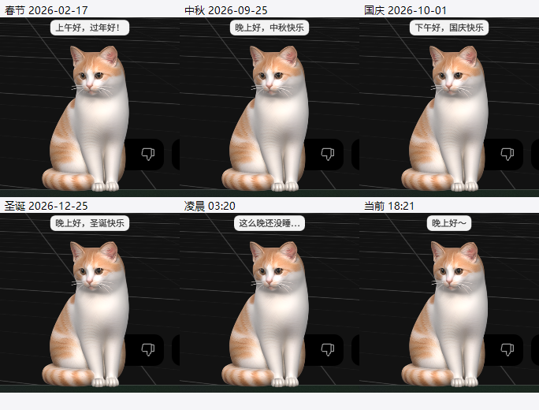
### 动作清单（9 组 200 帧，全部来自坐姿模型）

| 动作 | 目录 | 帧数 | 单帧 | 触发 |
| --- | --- | --- | --- | --- |
| 待机（侧脸） | `idle/` | 24 | 100ms | 默认循环 |
| 正脸待机 | `front/a|b|c/` | 6 / 20 / 6 | 100/110/100ms | 静置 25s 自动切换 |
| 喵叫 A/B/C | `say/a|b|c/` | 4 / 8 / 4 | 90/100/90ms | 点身体、右键 |
| 转头 A/B/C | `turn/a|b|c/` | 5 / 10 / 5 | 90/110/90ms | 静置随机 |
| 打盹 A/B/C | `sleep/a|b|c/` | 6 / 18 / 6 | 110/140/110ms | 静置 45s |
| 蹭手 A/B/C | `touch_head/a|b|c/` | 5 / 10 / 5 | 90/110/90ms | 点头顶、右键 |
| 打哈欠 | `yawn/` | 16 | 90ms | 静置随机、右键 |
| 歪头 | `tilt/` | 14 | 100ms | 静置随机 |
| 舔毛 A/B/C | `lick/a|b|c/` | 6 / 16 / 6 | 100/90/100ms | 静置随机、右键 |

### 气泡文案（按动作分组）

| 动作 | 文案池 |
| --- | --- |
| 喵叫 | 喵～ / 喵呜～ / 喵？ / 喵嗷～ |
| 蹭手 | （蹭蹭）/（蹭你的手）/（呼噜呼噜） |
| 打盹 | （打呼噜）/（睡着了）/（蜷成一团） |
| 舔毛 | （舔毛中）/（专心洗脸） |
| 打哈欠 | （打了个哈欠）/（伸了个懒腰） |
| 歪头 | 喵？ /（歪头） |

原则：拟声词 + 括号里的第三人称描述，不用人类说话的口吻。

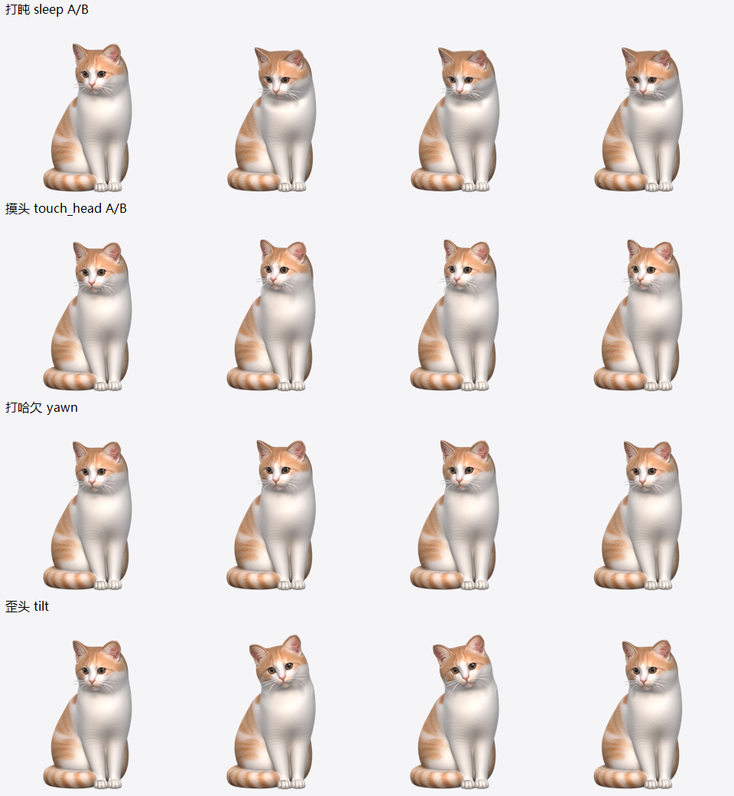

## 4. 提醒（番茄钟 / 喝水·久坐）——在托盘图标里

**入口都在系统托盘**（图标在溢出面板里，是个猫头）。宠物身上的右键菜单只留动作和设置。

| 托盘操作 | 作用 |
| --- | --- |
| 双击图标 | 显示 / 隐藏猫咪 |
| 右键 → **番茄钟 ▸** | 专注 15/25/45/60 分钟、休息 5/10 分钟、各自「自定义…」、暂停/停止、自动休息开关 |
| 右键 → **喝水/久坐 ▸** | 每 30/45/60/90 分钟、自定义间隔、关闭提醒 |
| 鼠标悬停 | 提示当前剩余时间 |
| 右键 → 退出 | 关掉程序 |

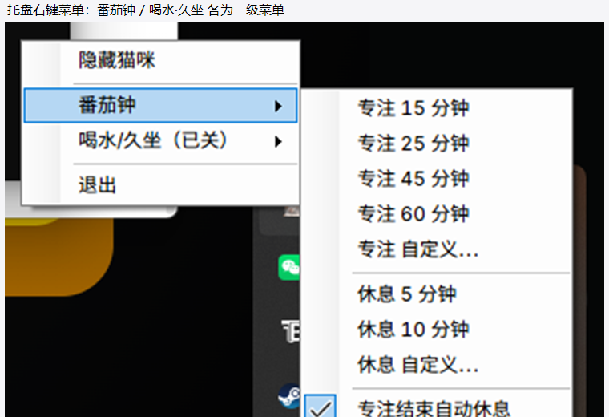

托盘菜单不好发现，所以猫会在**闲置一会儿后**主动提一句（最多 3 次，用过计时功能后自动闭嘴）：

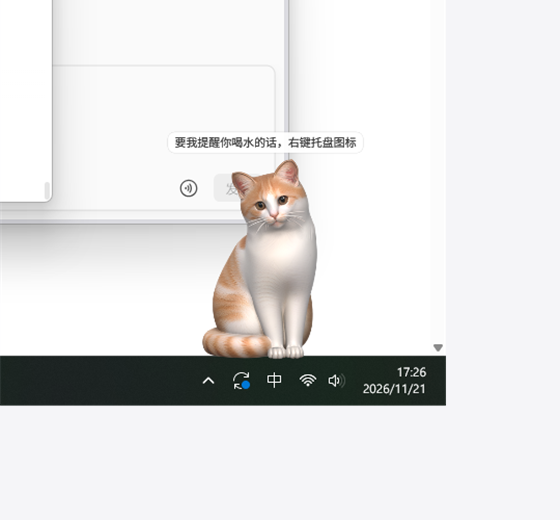

### 番茄钟

| 项 | 预设 | 说明 |
| --- | --- | --- |
| 专注 | 15 / 25 / 45 / 60 分钟 | 另有「专注 自定义…」可填 1~240 分钟 |
| 休息 | 5 / 10 分钟 | 另有「休息 自定义…」 |
| 结束行为 | 专注结束 → 气泡「专注结束，休息一下～」+ 猫叫；默认**自动进入休息**（可关） | 休息结束 → 气泡 + 打哈欠 |
| 运行中 | 菜单多出「暂停计时 / 停止计时」 | 暂停时倒计时显示「已暂停」 |

### 喝水 / 久坐提醒

| 项 | 取值 |
| --- | --- |
| 间隔 | 30 / 45 / 60 / 90 分钟，或「自定义…」 |
| 到点 | 气泡交替显示「（该喝水啦）」「（起来动一动）」，猫叫一声 |
| 关闭 | 「关闭提醒」，关闭后桌面不再显示倒计时 |

### 计时显示

窗口底部有一条小字：`专注 24:59   喝水 44:12`，只显示正在运行的计时（两个都在就都显示）。
设置写入 `%LOCALAPPDATA%\CatPet\settings.json`，重启后保留。
## 5. 素材从哪来（3D 烘焙管线）

```
artwork/source/cat_sitting.glb        原始模型（1.5M 三角面，无骨架/动画，不入库）
   ↓ prep.py          导入 + 减面到 11 万面 + 相机灯光 → cat_work.blend
   ↓ rig.py           13 根骨骼 + 程序化蒙皮权重      → cat_rigged.blend
   ↓ bake.py          逐帧算姿态，渲染 1000×1000 透明 PNG → frames/
artwork/inbox/<动作>/                 按动作目录整理
   ↓ import-artwork.ps1               校验 + 备份 + 拷贝进 mod
CatPet/src/CatPet/mod/MyCat/pet/cat/  程序实际读取的素材
```

跑法（Blender 5.x）：

```powershell
$bl = "<Blender>\blender.exe"
& $bl -b --python artwork\blender\prep.py     # 减面，约 1 分钟
& $bl -b --python artwork\blender\rig.py      # 绑骨，约 30 秒
& $bl -b --python artwork\blender\bake.py     # 全部动作，约 1 分钟
```

骨架与轴向（改动画必须对齐）：

| 骨骼 | 作用 | 轴向 |
| --- | --- | --- |
| `head` | 转头 / 抬头 | Z = 左右转头，X = 低头抬头，Y = 歪头 |
| `ear_L/R` | 耳朵 | X = 后压，Y = 外张 |
| `jaw` | 张嘴 | X = 张开；权重半径 0.062 时 30° 明显且不变形 |
| `chest` / `body` | 呼吸 | 缩放（幅度要小，1% 足够） |
| `tail_5` | 尾尖轻摆 | Z（≤8°；根部骨骼不要动，会撕网格） |
| `root` | 整体转向 | Z（正脸待机 = -25°） |

## 6. 工具

| 脚本 | 用途 |
| --- | --- |
| `artwork/blender/prep.py` | glb → 减面 + 相机/灯光，产出 `cat_work.blend` |
| `artwork/blender/rig.py` | 建骨架 + 程序化权重，产出 `cat_rigged.blend` |
| `artwork/blender/bake.py` | 烘焙坐姿动作到 `artwork/blender/frames/` |
| `artwork/blender/bake_stand3.py` | 方案 A 模型上烘焙站立待机 / 摇尾巴到 `frames_stand3/` |
| `artwork/blender/bake_stand_walk.py` | 方案 A 模型上烘焙左 / 右两个方向的侧视行走 |
| `CatPet/tools/validate-frames.ps1` | 校验尺寸 / Alpha / 命名 / 序号 / 帧数 / 贴底 |
| `CatPet/tools/import-artwork.ps1` | 校验 + 备份 + 导入 mod；`-Fit` 才做归一化 |
| `CatPet/tools/make-icon.ps1` | 从形象帧生成多尺寸 `app.ico` |
| `CatPet/tools/pack.ps1` | 一键打包：绿色版 / 单文件 / zip / 安装包 |
| `CatPet/tools/installer/CatPet.iss` | Inno Setup 安装包脚本 |

## 7. 目录结构

```
CatPet/
├── src/CatPet/
│   ├── Core/          Lps 解析、GraphBook、FrameAnimation（精灵图合成）、PetPlayer、Settings
│   ├── PetWindow.*    透明置顶窗口、拖动、热区、气泡、调整大小
│   └── mod/MyCat/pet/ 形象数据（cat.lps 热区 / cat/info.lps 动画声明 / 各动作帧）
└── tools/             validate-frames.ps1 / import-artwork.ps1

artwork/
├── source/            源模型（不入库）
├── blender/           prep/rig/bake 三个脚本 + 中间 blend + frames（不入库）
└── inbox/             导入暂存（不入库）
```

## 8. 与 VPet 的对应关系

| VPet | 本项目 |
| --- | --- |
| `Core/GraphInfo` | `Core/GraphInfo.cs`（GraphType × AnimatType × ModeType） |
| `Info.lps` 的 `PNGAnimation#...` | 同格式，`mod/MyCat/pet/cat/info.lps` |
| 文件名末尾数字 = 帧时长(ms) | 一致 |
| 精灵图（横排拼帧 + `CroppedBitmap` 裁剪） | `Core/FrameAnimation.cs` |
| `PetLoader` 从 mod 目录推断动画 | `Core/PetLoader.cs` |

## 9. 已知限制

- 模型是**坐姿**：走路、抬爪洗脸这类动作做不了（腿没有关节环线，超过 65° 网格会折叠）
- 网格没有独立眼睑，**做不了眨眼**
- 尾巴只有尾尖能动，根部一转整条尾巴会炸开
- 正脸待机是整体绕 Z 转 -25°，脚会跟着轻微转动（22~25° 范围内不明显）

## 10. 踩过的坑

- **删掉某个动画后要把 `bin\Debug\net8.0-windows\mod` 里同名的旧目录也删掉**：`dotnet build` 只覆盖不清理
- **帧名前缀要和目录约定一致**：`touch_head\a` 用 `head_a_` 前缀，导入工具按目录重新命名，校验脚本按前缀核对
- **`DrawImage(src, 0, 0)` 会按 DPI 缩放**：处理 4096 贴图时要用显式目标矩形
- **贴图空间大半径模糊会串 UV 岛**：这个模型的 UV 是碎片化 atlas，只能做小半径滤波或几何感知平滑
- PowerShell 里 `$NoFit`/`$nofit` 是同一个变量（大小写不敏感），命名要区分开
- `.ps1` 文件必须存成 **UTF-8 with BOM**，否则中文注释会让脚本解析失败

## 11. 打包发布

一条命令，只产出**安装包**（自包含 .NET 8，目标机不需要装运行时）：

```powershell
.\CatPet\tools\pack.ps1                    # → dist\CatPet-Setup-1.0.0.exe（约 178 MB）
.\CatPet\tools\pack.ps1 -Version 1.0.1     # 换版本号
```

脚本只做打包，**不会启动程序**。

| 步骤 | 内容 |
| --- | --- |
| 1 | `make-icon.ps1` 从当前形象的待机帧生成 `app.ico`（exe / 安装包图标） |
| 2 | `dotnet publish --self-contained win-x64` 到 `dist\_publish`（约 295 MB） |
| 3 | Inno Setup 编译成 `dist\CatPet-Setup-<版本>.exe`（LZMA2） |
| 4 | 删除 `_publish` 中间目录（内容已内嵌进安装包） |

需要别的形态时加参数（默认都不做）：

| 参数 | 产物 |
| --- | --- |
| `-WithZip` | `dist\CatPet-绿色版.zip`（解压即用） |
| `-WithSingle` | `dist\CatPet-单文件\`（exe 60 MB + mod） |
| `-KeepStaging` | 保留 `dist\_publish` 便于排查 |
| `-Iscc <路径>` | 手动指定 ISCC.exe |

### 安装包内容

- 装到 `Program Files\CatPet`，当前用户权限即可，无需管理员（但**建议管理员运行**，避免临时目录权限问题）
- 开始菜单 + 可选桌面快捷方式、可选开机自启、标准卸载
- 卸载只删程序目录，保留 `%LOCALAPPDATA%\CatPet\settings.json`

### 依赖与限制

- 目标机 **Win10 x64 及以上**，不需要 .NET
- 不要开 `PublishTrimmed`：WPF 不支持裁剪
- `mod\` 素材不塞进单文件 exe（149 MB，会导致运行时读不到），所以「单文件」形态下 exe 旁边的 `mod\` 必须跟着

### 三种方案怎么选

| 方案 | 自带依赖 | 单文件 | 适用 |
| --- | --- | --- | --- |
| 安装包 | ✅ 自包含 .NET 8（含 WPF/WinForms） | 一个 exe 安装器 | **推荐**，给普通用户 |
| 绿色版 zip | ✅ 同上 | 一个 zip，解压成文件夹 | 不想安装、U 盘携带 |
| 单文件 exe + mod | ✅ 同上 | exe 单文件，但素材仍是文件夹 | 想"一个 exe"又不想重编译素材 |

### 为什么素材不塞进单文件

`mod\` 有 **149 MB / 200 张 PNG**。全塞进 exe 会变成 212 MB 的巨物，首次启动要解压到临时目录（实测在受限环境会报
`Failed to create default extraction directory ... error code: 5`），而且用户改不了素材。所以
`CatPet.csproj` 里给素材加了 `ExcludeFromSingleFile="true"`，保持 exe 旁边一个可替换的 `mod\` 目录。

真要"绝对单个文件"，把 `ExcludeFromSingleFile` 去掉即可，代价是 212 MB、启动变慢、素材不可替换。

### 图标

`tools\make-icon.ps1` 从当前形象的待机帧裁头部，生成 7 种尺寸的 `app.ico`（16/24/32/48/64/128/256），
`pack.ps1` 每次打包前会重新生成，所以换素材后 exe 图标和安装包图标会自动跟着变。

### 手动命令（不想用脚本时）

```powershell
# 自包含文件夹版
dotnet publish CatPet\src\CatPet\CatPet.csproj -c Release -r win-x64 --self-contained true -o dist\CatPet-绿色版

# 单文件版
dotnet publish CatPet\src\CatPet\CatPet.csproj -c Release -r win-x64 --self-contained true `
  -p:PublishSingleFile=true -p:EnableCompressionInSingleFile=true -p:DebugType=None -o dist\CatPet-单文件

# 安装包（先装 Inno Setup 6：winget install JRSoftware.InnoSetup）
"$env:LOCALAPPDATA\Programs\Inno Setup 6\ISCC.exe" `
  "/DMySourceDir=dist\CatPet-绿色版" "/DMyVersion=1.0.0" "/DMyOutputDir=dist" `
  CatPet\tools\installer\CatPet.iss
```

### 注意

- 项目**不能开** `PublishTrimmed`：WPF 不支持裁剪，会运行时炸
- 单文件 pattern 依赖临时目录可写；被 AppLocker/杀软限制的环境请用绿色版或安装包
- 安装包用当前用户权限安装（`PrivilegesRequired=lowest`），不需要管理员，卸载项写在 `HKCU`
